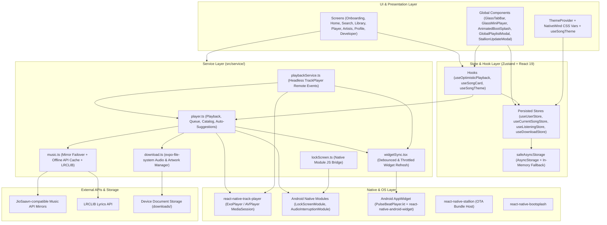
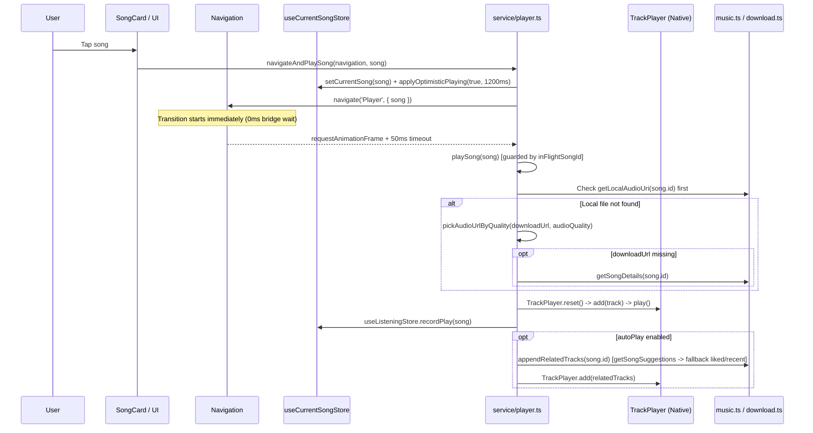
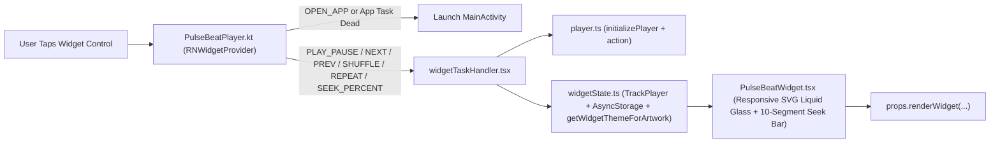

# PulseBeat — Technical Architecture & System Flows

PulseBeat is a local-first, cross-platform music streaming and offline playback application built on **React Native 0.88.1 (New Architecture / Bridgeless)**, **React 19.3**, and **Expo Modules (~58.0.0)**. It combines background native audio playback, offline file downloads, multi-mirror API failover with AsyncStorage caching, synced LRC lyrics, dynamic album-art theming, an interactive Android liquid-glass home screen widget, Android lock-screen player support, and Stallion Over-the-Air (OTA) updates.

---

## Table of Contents

1. [System Architecture Overview](#1-system-architecture-overview)
2. [Tech Stack & Libraries Used](#2-tech-stack--libraries-used)
3. [Project & Module Structure](#3-project--module-structure)
4. [Core End-to-End Flows](#4-core-end-to-end-flows)
   - [4.1 App Boot, Hydration & OTA Lifecycle](#41-app-boot-hydration--ota-lifecycle)
   - [4.2 Navigation & Screen Hierarchy](#42-navigation--screen-hierarchy)
   - [4.3 Audio Playback, Queue & Optimistic UI Flow](#43-audio-playback-queue--optimistic-ui-flow)
   - [4.4 Background Service, Remote Controls & Interruption Handling](#44-background-service-remote-controls--interruption-handling)
   - [4.5 Music API Failover, Offline Cache & Synced Lyrics](#45-music-api-failover-offline-cache--synced-lyrics)
   - [4.6 Offline Downloads & Local-First Audio Resolution](#46-offline-downloads--local-first-audio-resolution)
   - [4.7 State Management & Persistence](#47-state-management--persistence)
   - [4.8 Dual Theming Engine (Preset Themes + Song-Adaptive Colors)](#48-dual-theming-engine-preset-themes--song-adaptive-colors)
   - [4.9 Android Home Screen Widget Architecture](#49-android-home-screen-widget-architecture)
   - [4.10 Android Lock-Screen Native Modules](#410-android-lock-screen-native-modules)
5. [Build, Patching, OTA & Testing](#5-build-patching-ota--testing)
6. [Environment Variables](#6-environment-variables)

---

## 1. System Architecture Overview

PulseBeat follows a layered, local-first architecture where **Zustand stores** hold persisted UI/domain state, **service modules** orchestrate native audio, file downloads, widgets, and resilient networking, and **native Android/iOS bridges** handle background media sessions, lock-screen visibility, call/ringtone interruptions, and home screen widget rendering.



---

## 2. Tech Stack & Libraries Used

### Core Runtime & Framework
| Library | Version | Purpose in PulseBeat |
|---|---|---|
| `react` | `19.3.0` | UI runtime; uses React 19 `useOptimistic` and `useTransition` in `useOptimisticPlayback` |
| `react-native` | `0.88.1` | Cross-platform runtime with New Architecture (`RCTNewArchEnabled` / `fabricEnabled`) enabled |
| `expo` | `~58.0.0` | Expo runtime/config (`@expo/env` in Metro, `expo-file-system` for modern `Directory`/`File`/`Paths` downloads, `babel-preset-expo`) |
| `typescript` | `^6.0.3` | Static typing across services, stores, navigation, and components |
| `react-native-worklets` | `^0.14.0` | Worklet runtime backing Reanimated animations |

### Audio Engine & Media Intelligence
| Library | Version | Purpose in PulseBeat |
|---|---|---|
| `react-native-track-player` | `^4.1.2` | Native background audio engine, queue management, lock-screen/notification media controls, repeat modes, and headless `PlaybackService` |
| `react-native-image-colors` | `^2.6.1` | Extracts dominant/vibrant/accent hex colors from album artwork on Android & iOS for the player UI and home screen widget |

### Navigation & Screen Infrastructure
| Library | Version | Purpose in PulseBeat |
|---|---|---|
| `@react-navigation/native` | `^7.5.2` | Navigation container & theme integration |
| `@react-navigation/native-stack` | `^7.21.1` | Native stack transitions (`Onboarding`, `MainTabs`, `Player`, `Artists`, `ArtistSongs`, `Developer`) |
| `@react-navigation/bottom-tabs` | `^7.22.0` | 4-tab main navigator (`Home`, `Search`, `Library`, `Profile`) with `lazy: true` and `freezeOnBlur: true` |
| `react-native-screens` | `^4.30.1` | Native screen containers & Android fragment restoration (`RNScreensFragmentFactory`) |
| `react-native-safe-area-context` | `^5.11.1` | Safe-area insets for notches, status bars, `GlassTabBar`, and `GlassMiniPlayer` |

### Styling, Animations & Visual Effects
| Library | Version | Purpose in PulseBeat |
|---|---|---|
| `nativewind` + `tailwindcss` | `4.2.7` / `^3.4.17` | Tailwind utility classes mapped to runtime CSS variables (`--color-*`) via `nativewind/metro` and `vars()` |
| `react-native-reanimated` | `^4.8.0` | Smooth 60/120fps animations (e.g., Developer screen pulse rings, player interactions) |
| `react-native-linear-gradient` | `^2.8.3` | Multi-stop backgrounds, player panels, and ambient overlays |
| `@react-native-community/blur` | `^4.4.1` | Native frosted glass blur on iOS for `GlassTabBar`, `GlassMiniPlayer`, and cards (with translucent surface fallback on Android) |
| `react-native-svg` | `^15.16.1` | Vector rendering in UI and SVG-powered widget graphics |
| `react-native-vector-icons` | `^10.3.0` | `Feather` icon set across navigation, controls, and modals |
| `react-native-bootsplash` | `^7.4.0` | Native launch screen (`BootTheme` / `BootSplash.storyboard`) handed off seamlessly into `AnimatedBootSplash` |

### State Management & Storage
| Library | Version | Purpose in PulseBeat |
|---|---|---|
| `zustand` | `^5.1.0` | Lightweight global state with `persist` + `createJSONStorage` middleware |
| `@react-native-async-storage/async-storage` | `^3.1.1` | Persistent key-value storage for stores, API offline cache, and developer shoutout flags |

### Platform Extensions & OTA Updates
| Library | Version | Purpose in PulseBeat |
|---|---|---|
| `react-native-android-widget` | `^0.26.0` | Renders JSX widget trees (`FlexWidget`, `OverlapWidget`, `SvgWidget`, `ImageWidget`, `TextWidget`) to native Android `RemoteViews` |
| `react-native-stallion` + `stallion-cli` | `^2.4.2` / `^2.6.0` | Over-the-Air JS bundle delivery (`withStallion`, `useStallionUpdate`, `Stallion.getJSBundleFile`, `StallionModule.getBundleURL`) |

---

## 3. Project & Module Structure

```text
Pulsebeat/
├── index.js                          # AppRegistry, TrackPlayer PlaybackService, Android WidgetTaskHandler registration
├── App.tsx                           # Root providers, player init, BootSplash coordination, global modals, withStallion HOC
├── metro.config.js                   # @expo/env loader + Expo/RN metro merge + withNativeWind(global.css)
├── babel.config.js                   # babel-preset-expo + nativewind/babel
├── tailwind.config.js                # CSS-variable-backed semantic color tokens & glass tokens
├── scripts/
│   ├── patch-expo.js                 # postinstall patches for RN 0.88 New Arch (TrackPlayer, css-interop, expo-modules-jsi)
│   └── ota-release.js                # CLI wrapper around stallion publish-bundle & release-bundle
├── src/
│   ├── config/
│   │   └── api.ts                    # Env-driven API_MIRRORS, MUSIC_PATHS, MUSIC_API endpoints
│   ├── types/
│   │   └── song.ts                   # Song, Artist, SongAlbum, ImageQuality, DownloadQuality interfaces
│   ├── theme/
│   │   ├── presets.ts                # 6 theme presets (pulse, cool, warm, winter, hot, aurora) + CSS RGB vars
│   │   ├── ThemeProvider.tsx         # useAppTheme() hook & ThemedContainer (injects NativeWind vars)
│   │   ├── songPalette.ts            # Artwork color extraction, luminance contrast, widget palette builder
│   │   └── colors.ts / spacing.ts / typography.ts / borderRadius.ts
│   ├── store/
│   │   ├── storage.ts                # safeAsyncStorage wrapper with in-memory fallback
│   │   ├── useUserStore.ts           # Onboarding, languages, genres, artists, profile, quality, autoPlay, repeat, themeId
│   │   ├── useCurrentSongStore.ts    # currentSong (persisted), isPlaying, isShuffle, isRepeat, hydration flag
│   │   ├── useListeningStore.ts      # likedSongs, recentPlays, recentSearches, playlists, playCounts, artistPlayCounts, modal state
│   │   └── useDownloadStore.ts       # downloads map, downloadOrder, transient activeDownloads progress
│   ├── service/
│   │   ├── player.ts                 # Player lifecycle, play/queue/skip/seek, catalog cache, related-track auto-queue
│   │   ├── playbackService.ts        # Headless TrackPlayer event listener (remote controls, ducking, widget progress)
│   │   ├── music.ts                  # Mirror failover HTTP client, AsyncStorage offline cache, LRCLIB lyrics search
│   │   ├── download.ts               # expo-file-system download manager, concurrency pool, local URI resolvers
│   │   ├── audioUtils.ts             # HTML entity decoder & quality-based audio URL selector
│   │   ├── lockScreen.ts             # JS wrapper over Android LockScreenModule
│   │   └── widgetSync.tsx            # Debounced widget update & 1.8s-throttled progress sync
│   ├── hooks/
│   │   ├── useOptimisticPlayback.ts  # React 19 useOptimistic play/pause toggling
│   │   ├── useSongCard.ts            # Shared song card state, navigation, and playlist modal trigger
│   │   └── useSongTheme.ts           # Song-artwork-reactive PlayerTheme hook
│   ├── widgets/
│   │   ├── PulseBeatWidget.tsx       # 3-tier adaptive liquid-glass SVG Android widget UI
│   │   ├── widgetState.ts            # Snapshot builder from TrackPlayer + AsyncStorage fallback + dynamic theme
│   │   └── widgetTaskHandler.tsx     # Handles WIDGET_ADDED/UPDATE/RESIZED/CLICK/DELETED
│   ├── components/
│   │   ├── global/                   # AnimatedBootSplash, GlassTabBar, GlassMiniPlayer, GradientBackground, GlobalPlaylistModal, StallionUpdateModal
│   │   └── ui/                       # PlayButton, ProgressBar, DownloadButton
│   └── screens/
│       ├── onboarding/               # 3-step personalization (Languages -> Genres -> Artists with live search)
│       ├── HomeScreen/               # Language/Genre/Artist feeds with in-memory tab caches & offline banner
│       ├── SearchScreen/             # Debounced multi-scope search (Songs, Artists, Albums, Playlists), moods, pagination
│       ├── LibraryScreen/            # Downloads, local playlists, liked songs, recent plays, curated playlists
│       ├── PlayerScreen/             # Dynamic-themed player, scrubbing ProgressBar, QueueModal, LyricsModal, lock-screen mode
│       ├── ArtistsScreen/            # Browse/manage artists
│       ├── ArtistSongsScreen/        # Artist discography & queue playback
│       ├── ProfileScreen/            # Listening stats, preferences, 6-theme switcher, audio quality, Stallion OTA status
│       └── DeveloperScreen/          # Creator info, GitHub stars fetch, ntfy shoutout integration
├── android/app/src/main/
│   ├── AndroidManifest.xml           # MainActivity (singleTask) & PulseBeatPlayer AppWidget receiver
│   └── java/com/pulsebeat/
│       ├── MainActivity.kt           # RNScreensFragmentFactory + RNBootSplash.init + ReactActivityDelegateWrapper
│       ├── MainApplication.kt        # ExpoReactHostFactory + LockScreenPackage + Stallion.getJSBundleFile
│       ├── lockscreen/
│       │   ├── LockScreenPackage.kt  # Registers LockScreenModule & AudioInterruptionModule
│       │   ├── LockScreenModule.kt   # setShowWhenLocked, isAppRunning, isDeviceLocked, requestDismissKeyguard
│       │   └── AudioInterruptionModule.kt # AudioManager.OnModeChangedListener for calls/ringtones
│       └── widget/
│           └── PulseBeatPlayer.kt    # RNWidgetProvider subclass intercepting OPEN_APP or dead-task clicks
├── ios/PulseBeat/
│   ├── SceneDelegate.swift           # ExpoReactNativeFactory + RNBootSplash + StallionModule.getBundleURL
│   └── Info.plist                    # UIBackgroundModes=[audio], RCTNewArchEnabled=true, Stallion credentials
└── __tests__/                        # Jest unit tests (App, download, interruptionHandling, optimisticPlayback, remoteControls, theme)
```

---

## 4. Core End-to-End Flows

### 4.1 App Boot, Hydration & OTA Lifecycle

1. **Entry Registration (`index.js`)**:
   - Registers the root React component `App` via `AppRegistry.registerComponent`.
   - Registers `playbackService` with `TrackPlayer.registerPlaybackService`.
   - On Android, registers `widgetTaskHandler` with `registerWidgetTaskHandler` so home screen widget events can execute even headless.
2. **Native Launch & Bundle Selection**:
   - **Android**: `MainActivity.onCreate` installs `RNScreensFragmentFactory` and initializes `RNBootSplash.init(this, R.style.BootTheme)`. `MainApplication` configures `ExpoReactHostFactory`, adds `LockScreenPackage()`, and in release builds loads the JS bundle via `Stallion.getJSBundleFile(applicationContext)`.
   - **iOS**: `SceneDelegate` boots `ExpoReactNativeFactory`, initializes `RNBootSplash.initWithStoryboard("BootSplash", ...)`, and in release builds loads the bundle via `StallionModule.getBundleURL()`.
3. **React Initialization (`App.tsx`)**:
   - Wrapped with `withStallion(App)` for OTA tracking and update detection.
   - Calls `initializePlayer()` on mount (`TrackPlayer.setupPlayer({ autoHandleInterruptions: true })`, applies `playerOptions`, registers playback listeners, restores `RepeatMode.Track` if `repeatByDefault` is enabled).
   - Waits for both `playerReady` and `userHydrated` (`useUserStore._hasHydrated`) before triggering `AnimatedBootSplash`'s spring/fade exit animation (`BootSplash.useHideAnimation`).
4. **OTA Update Prompt (`StallionUpdateModal.tsx`)**:
   - Subscribes to `useStallionUpdate()`. When `isRestartRequired` becomes true, presents a themed modal displaying `newReleaseBundle.releaseNote` with a **Restart Now** action (`restart()`) and an optional **Later** button (hidden when `isMandatory` is true).

---

### 4.2 Navigation & Screen Hierarchy

PulseBeat uses a two-tier navigation structure defined in `src/navigation/index.tsx` and `src/navigation/Tabs/index.tsx`:

- **Root Native Stack (`RootNavigator`)**:
  - Waits for `useUserStore._hasHydrated` before rendering so `initialRouteName` deterministically opens `MainTabs` (returning users) or `Onboarding` (first-run users).
  - Stack screens:
    - `Onboarding` — 3-step personalization wizard (Languages → Genres → Artists).
    - `MainTabs` — Bottom Tab Navigator.
    - `Player` (`animation: 'fade_from_bottom'`) — Full-screen audio player, queue modal, and synced lyrics modal.
    - `Artists` (`animation: 'slide_from_right'`) — Artist directory.
    - `ArtistSongs` (`animation: 'slide_from_right'`) — Artist tracklist.
    - `Developer` (`animation: 'slide_from_right'`) — Developer showcase, GitHub star count, and shoutout sender.
- **Bottom Tabs (`AppTabs`)**:
  - `Home`, `Search`, `Library`, `Profile` with `lazy: true`, `freezeOnBlur: true`, and `animation: 'shift'`.
  - Uses a custom floating `GlassTabBar` with animated spring indicator (`Animated.spring`) and iOS `BlurView` / Android tinted translucent surface.
- **Persistent Overlays**:
  - `GlassMiniPlayer` floats above `GlassTabBar` across tab/stack screens, polling `useProgress(200)` only when focused (`useIsFocused()`).
  - `GlobalPlaylistModal` is mounted at the root in `App.tsx` so any screen or card can trigger `useListeningStore.getState().openPlaylistModal(song)`.

---

### 4.3 Audio Playback, Queue & Optimistic UI Flow

PulseBeat eliminates bridge latency when tapping a song by combining **optimistic UI updates**, **deferred navigation**, **in-memory catalog lookup**, and **automatic related-track queuing**:



Key design mechanisms in `src/service/player.ts` and `src/hooks/useOptimisticPlayback.ts`:
- **Optimistic Play/Pause Lock**: `useOptimisticPlayback` uses React 19's `useOptimistic` + `useTransition`, paired with `optimisticPlayingLock` (650ms–1200ms window) in `player.ts`. Transient `State.Buffering` / `State.Paused` events from the native bridge that contradict the user's immediate tap are ignored until the lock expires or the native state catches up.
- **In-Flight Deduplication**: `inFlightSongId` prevents duplicate `playSong` calls when tapping rapidly or when both `navigateAndPlaySong` and `PlayerScreen`'s mount effect fire.
- **Multi-Track Queue Playback (`playQueueAndNavigate`)**: Loads an entire album, playlist, or artist song list into `TrackPlayer.add(tracks)`, skips to `targetTrackIdx`, and starts playback.
- **Smart Skip Behavior**:
  - `skipToNextSong()`: Supports Shuffle (`Math.random()` avoiding current index) and automatically calls `appendRelatedTracks()` if at the end of the queue.
  - `skipToPreviousSong()`: Restarts the current track (`seekTo(0)`) if `progress.position > 4` seconds; otherwise skips to the previous queue item or falls back to `recentPlays`.
- **Queue Inspection & Editing**: `getQueueSongs()`, `skipToQueueIndex(index)`, and `removeFromQueue(index)` power `QueueModal.tsx`, reconstructing full `Song` metadata via `songCatalog` (`Map<string, Song>`), `listeningStore`, and `downloadStore`.

---

### 4.4 Background Service, Remote Controls & Interruption Handling

`src/service/playbackService.ts` runs as TrackPlayer's registered `PlaybackService` (including when the UI is backgrounded) and keeps subscriptions idempotent via `clearSubscriptions()`:

- **Remote Media Controls** (Lock screen, Notification shade, Bluetooth/Headset):
  - `Event.RemotePlay`: Checks `TrackPlayer.getActiveTrack()`. If the native queue was cleared, reads the last song from `useCurrentSongStore` or directly from `AsyncStorage.getItem('song-storage')` (`getFallbackSong()`) and calls `playSong(fallbackSong)`; otherwise calls `resumeSong()`.
  - `Event.RemotePause` / `Event.RemoteStop` / `Event.RemoteNext` / `Event.RemotePrevious` / `Event.RemoteSeek` / `Event.RemoteSkip`: Delegate to `player.ts` helpers.
  - `Event.RemoteJumpForward` / `Event.RemoteJumpBackward`: Seek by `event.interval` (default `10s`) via `seekBy()`.
- **Audio Focus & Phone Call Interruptions**:
  - `Event.RemoteDuck`: Pauses playback and syncs store/widget state on permanent or paused audio ducking.
  - **Android `AudioInterruptionModule` + `AppState`**: `player.ts` listens to native `AudioInterruption` events (triggered when `AudioManager.mode` enters `MODE_RINGTONE`, `MODE_IN_CALL`, or `MODE_IN_COMMUNICATION`) and also queries `isInterruptionActive()` on `AppState` transitions so playback pauses reliably during incoming/active calls.
- **Widget Progress Sync**: `Event.PlaybackProgressUpdated` triggers `syncWidgetProgress(position, duration)` (throttled to ~1.8s).

---

### 4.5 Music API Failover, Offline Cache & Synced Lyrics

All catalog, search, and lyrics requests flow through `src/service/music.ts` and `src/config/api.ts`:

1. **Multi-Mirror Failover (`fetchMusicEndpoint`)**:
   - `API_MIRRORS` is built from `EXPO_PUBLIC_MUSIC_API_MIRRORS` (comma-separated), `EXPO_PUBLIC_MUSIC_API_URL`, and `EXPO_PUBLIC_MUSIC_API_FALLBACK_URL`.
   - Tracks `activeMirrorIndex` (last known healthy mirror) and cycles through all configured mirrors with a **6,000 ms `AbortController` timeout** per request until a valid JSON object is returned.
2. **Stale-on-Error Offline Cache (`fetchWithOfflineCache`)**:
   - Feeds (`getHomeData`, `getPopularArtists`, `getSongsByGenre`, `getSongsByLanguage`, `getPlaylistBySearch`, `getSongDetails`, `getAlbumDetails`, `getArtistDetails`, `getArtistSongs`, `getPlaylistDetails`) write successful responses to `AsyncStorage` under `@pulsebeat_api_cache:<key>`.
   - On network failure across all mirrors, `readCache()` serves cached data tagged with `_fromCache: true`, allowing `HomeScreen` to show an offline indicator while remaining browsable.
3. **Synced & Plain Lyrics (`getSongLyrics` + `LyricsModal.tsx`)**:
   - Strips bracketed metadata (`[Remix]`, `(Live)`, etc.) from the title and queries `EXPO_PUBLIC_LYRICS_API_URL` (LRCLIB) using `track_name` + `artist_name` (up to 2 primary artists), falling back to a free-text `q` query.
   - Filters out instrumental tracks, ranks results preferring `syncedLyrics` and closest `duration` match, parses `[mm:ss.xx]` LRC timestamps in `LyricsModal.tsx`, highlights the active line against `useProgress(250)`, auto-scrolls, and lets users tap any lyric line to seek (`seekTo(line.timeSec)`).

---

### 4.6 Offline Downloads & Local-First Audio Resolution

Implemented in `src/service/download.ts` and `src/store/useDownloadStore.ts`:

- **Storage Location**: Uses Expo's object-oriented filesystem (`Directory`, `File`, `Paths.document`) under `<document>/downloads/`.
- **Download Pipeline (`downloadSong`)**:
  1. Deduplicates concurrent requests via `inFlightPromises` (`Map<string, Promise>`) and skips if `getLocalAudioUri(song.id)` already exists on disk.
  2. Resolves the stream URL according to `useUserStore.audioQuality` (`high` = highest bitrate entry, `medium` = middle entry, `low` = first entry), calling `getSongDetails()` if `downloadUrl` is absent.
  3. Streams audio via `File.downloadFileAsync(..., { signal: controller.signal, onProgress })`, throttling store updates (`PROGRESS_THROTTLE_MS = 140` or ≥3% delta) to avoid re-render churn.
  4. Verifies `downloadedFile.exists && fileSize > 0` (cleaning up partial files on abort/failure).
  5. Best-effort downloads album artwork (`<safeId>_art.<ext>`) via `downloadArtworkBestEffort()`.
  6. Persists `DownloadedSongRecord` into `useDownloadStore` (`downloads` map + `downloadOrder` LRU-style array).
- **Batch Downloads (`downloadSongsBatch`)**: Runs a worker pool with default `concurrency = 2` (used for downloading whole playlists/liked collections).
- **Local-First Playback**: Both `toTrackItem()` and `playSong()` in `player.ts` check `getLocalAudioUri(song.id)` and `getLocalArtworkUri(song.id)` before falling back to remote URLs, enabling zero-buffering offline playback.

---

### 4.7 State Management & Persistence

All global state lives in four Zustand stores backed by `safeAsyncStorage` (which wraps `AsyncStorage` with an in-memory `Map` fallback if the native module is unavailable during early startup or tests):

| Store | Storage Key | Persisted Fields | Transient / Runtime Fields |
|---|---|---|---|
| `useUserStore` | `pulsebeat-user-preferences` | `hasCompletedOnboarding`, `selectedLanguages` (normalized), `selectedGenres` (normalized), `selectedArtists`, `artistNames`, `artistProfiles`, `profileName`, `profileHandle`, `avatarId`, `joinedAt`, `audioQuality`, `autoPlay`, `repeatByDefault`, `themeId` | `_hasHydrated` |
| `useCurrentSongStore` | `song-storage` | `currentSong` | `isPlaying`, `isShuffle`, `isRepeat`, `_hasHydrated` |
| `useListeningStore` | `pulsebeat-listening-stats` | `likedSongs`, `recentPlays` (capped at 30), `recentSearches` (capped at 8), `playlists`, `playCounts` (capped at top 60 most recent), `artistPlayCounts`, `totalListeningSeconds` | `playlistModalVisible`, `playlistModalSong` |
| `useDownloadStore` | `pulsebeat-downloads` | `downloads`, `downloadOrder` | `activeDownloads` (progress, bytesWritten, totalBytes) |

---

### 4.8 Dual Theming Engine (Preset Themes + Song-Adaptive Colors)

PulseBeat uses two complementary theming systems:

1. **App-Wide Preset Themes (`src/theme/presets.ts`, `src/theme/ThemeProvider.tsx`, `tailwind.config.js`)**:
   - Six curated presets (`pulse`, `cool`, `warm`, `winter`, `hot`, `aurora`), each defining RGB triplets (`ThemeRgbTokens`), structured `AppThemeColors`, `AppThemeGradients`, and CSS variables (`--color-bg`, `--color-accent`, `--color-glass-tint`, etc.).
   - `ThemedContainer` applies NativeWind's `vars(preset.cssVars)` at the app root (`App.tsx`) and modals, so Tailwind classes such as `bg-background`, `text-accent`, `border-glass-border`, and `bg-glass-tint` update instantaneously across the app when switching themes in `ProfileScreen`.
2. **Song-Adaptive Player & Widget Palette (`src/theme/songPalette.ts`, `src/hooks/useSongTheme.ts`)**:
   - `extractRawSongColors(imageUrl, timeoutMs)` calls `react-native-image-colors` (`getColors`) with caching (`paletteCache` `Map`) and a race timeout (`4000ms` in `useSongTheme`, `1500ms` in widget updates), extracting `dominant`/`vibrant`/`lightVibrant` on Android or `primary`/`secondary`/`detail` on iOS.
   - `useSongTheme(artwork)` computes darkened backgrounds, panel gradients, orb glows, and progress colors for `PlayerScreen`.
   - `buildWidgetTheme(raw)` enforces vivid accents (`ensureVividAccent`) and WCAG-style relative luminance contrast (`onAccent`: `#0B1309` vs `#FFFFFF`) for the Android widget.

---

### 4.9 Android Home Screen Widget Architecture

PulseBeat provides a rich, interactive Android home screen widget (`PulseBeatPlayer`):



- **Native Entry (`PulseBeatPlayer.kt` & `AndroidManifest.xml`)**:
  - Extends `RNWidgetProvider`. Intercepts `WIDGET_CLICK` intents: if `clickAction` is `OPEN_APP` or `ActivityManager.appTasks` is empty (app killed), it launches `MainActivity` directly rather than leaving a dead widget state.
- **Headless Task Handler (`src/widgets/widgetTaskHandler.tsx`)**:
  - Handles `WIDGET_ADDED`, `WIDGET_UPDATE`, `WIDGET_RESIZED`, `WIDGET_CLICK`, and `WIDGET_DELETED`.
  - Supports `PLAY_PAUSE` (resuming active track or cold-booting `getPersistedCurrentSong()`), `NEXT`, `PREVIOUS`, `SHUFFLE`, `REPEAT`, and `SEEK_PERCENT` (mapping 10 invisible `SEEK_SEGMENTS` `[0..0.96]` overlaid on the progress bar to `ratio * duration`).
  - Applies immediate optimistic `ClickOverrides` before calling `props.renderWidget()`.
- **UI & Synchronization (`PulseBeatWidget.tsx`, `widgetSync.tsx`)**:
  - Generates dynamic SVG markup for the liquid-glass card background (`buildLiquidGlassBgSvg` with multi-stop gradients, specular highlight, liquid waves, and rim stroke), progress bar, equalizer, and PulseBeat emblem.
  - Adapts across 3 height tiers (`isCompact < 132`, `isMedium < 192`, full `>= 192`) and narrow widths (`< 255`).
  - `widgetSync.tsx` coalesces rapid state changes with an `80ms` debounce (`syncPlaybackWidget`) and serializes concurrent updates (`updateInFlight` + `hasPendingUpdate`) while throttling progress bar updates to every `1800ms` (`syncWidgetProgress`).

---

### 4.10 Android Lock-Screen Native Modules

Registered in `MainApplication.kt` via `LockScreenPackage.kt`:

1. **`LockScreenModule.kt` (`src/service/lockScreen.ts`)**:
   - `setShowWhenLocked(enabled)`: Uses `Activity.setShowWhenLocked(enabled)` (API 27+) or `FLAG_SHOW_WHEN_LOCKED` so `PlayerScreen` can remain visible over the Android lock screen while mounted.
   - `isDeviceLocked()` & `requestDismissKeyguard()`: In `PlayerScreen`'s `beforeRemove` navigation listener, if the device is locked, leaving the player prompts the Android keyguard unlock (`KeyguardManager.requestDismissKeyguard`) before dispatching the back navigation action.
   - `isAppRunning()`: Checks `ActivityManager.appTasks` so widgets accurately reflect stopped state when the app task is closed.
2. **`AudioInterruptionModule.kt`**:
   - On Android 12+ (`Build.VERSION_CODES.S`), registers an `AudioManager.OnModeChangedListener` watching `MODE_RINGTONE`, `MODE_IN_CALL`, and `MODE_IN_COMMUNICATION`, emitting `AudioInterruption` events over `RCTDeviceEventEmitter` to `player.ts` so music pauses immediately during calls. Also exposes `isInterruptionActive()` for `AppState` foreground reconciliation.

---

## 5. Build, Patching, OTA & Testing

### Postinstall Dependency Patches (`scripts/patch-expo.js`)
Executed automatically via `"postinstall": "node scripts/patch-expo.js"` to maintain compatibility with **React Native 0.88 (New Architecture / Bridgeless)** and **Xcode / Swift 6.2**:
1. **`expo-modules-jsi` (`JavaScriptObject.swift`)**: Fixes Swift 6.2 strict concurrency data-race errors on `slot` capture inside `JavaScriptActor.assumeIsolated`.
2. **`react-native-css-interop` (`render-component.js`)**: Wraps `stringify()` property enumeration in `try/catch` so inspecting React Navigation context getters does not throw.
3. **`react-native-track-player` (`MusicModule.kt` & `MusicService.kt`)**:
   - Adds null-safe `originalItem?.let { Arguments.fromBundle(it) }` in `getTrack`/`getActiveTrack`.
   - Rewrites `@ReactMethod` expression bodies (`= scope.launch { ... }`) to block bodies returning `Unit` instead of inferring `Job` (preventing `TurboModuleInteropUtils` crashes).
   - Replaces legacy `reactNativeHost.reactInstanceManager.currentReactContext` with `reactContext` in `MusicService.kt` for Bridgeless compatibility.

### Scripts (`package.json`)
| Script | Command | Description |
|---|---|---|
| `start` | `react-native start` | Starts Metro bundler (with `@expo/env` & NativeWind) |
| `android` / `ios` | `react-native run-android` / `run-ios` | Builds and launches native app |
| `lint` | `eslint .` | Runs ESLint checks |
| `test` | `jest` | Runs Jest test suite |
| `ota:login` | `stallion login` | Authenticates Stallion CLI |
| `ota:publish` / `ota:android` / `ota:ios` | `node scripts/ota-release.js ...` | Publishes (and optionally `--promote` / `--mandatory`) OTA JS bundles via `stallion-cli` |
| `ota:promote` | `stallion release-bundle` | Promotes an uploaded Stallion bundle |

### Automated Tests (`__tests__/`)
Jest (`jest.config.js` with `@react-native/jest-preset` and CSS mock `styleMock.js`) covers core logic in:
- `__tests__/App.test.tsx`
- `__tests__/download.test.ts`
- `__tests__/interruptionHandling.test.ts`
- `__tests__/optimisticPlayback.test.ts`
- `__tests__/remoteControls.test.ts`
- `__tests__/theme.test.ts`

---

## 6. Environment Variables

Configured via `.env` (loaded in Metro by `@expo/env` and in `scripts/ota-release.js`, see `.env.example`):

| Variable | Used By | Purpose |
|---|---|---|
| `EXPO_PUBLIC_MUSIC_API_URL` | `src/config/api.ts` | Primary JioSaavn-compatible API base URL |
| `EXPO_PUBLIC_MUSIC_API_FALLBACK_URL` | `src/config/api.ts` | Secondary fallback API URL |
| `EXPO_PUBLIC_MUSIC_API_MIRRORS` | `src/config/api.ts` | Optional comma-separated list of mirror URLs |
| `EXPO_PUBLIC_LYRICS_API_URL` | `src/config/api.ts` | Lyrics search endpoint (e.g. `https://lrclib.net/api/search`) |
| `EXPO_PUBLIC_SHOUTOUT_URL` | `src/config/api.ts` | Optional ntfy endpoint used by `DeveloperScreen` |
| `EXPO_PUBLIC_GITHUB_REPO_API` | `src/config/api.ts` | Optional GitHub repo API URL for live stargazer count |
| `STALLION_UPLOAD_PATH` | `scripts/ota-release.js` | `<org/project/bucket>` target for Stallion OTA uploads |
| `STALLION_PROJECT_ID` / `STALLION_APP_VERSION` / `STALLION_CI_TOKEN` | `scripts/ota-release.js` | Optional promotion and CI authentication settings |
